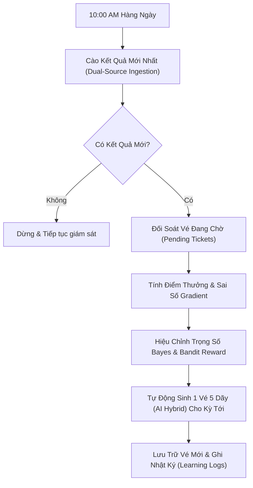

# 📖 Hướng Dẫn Vận Hành & Khai Thác Hệ Thống (Operations Manual)

Tài liệu này cung cấp hướng dẫn chi tiết dành cho kỹ sư vận hành, quản trị viên hệ thống hoặc người dùng nâng cao nhằm duy trì sự ổn định, giám sát chu kỳ tự động và bảo trì nền tảng **Vietlott AI Analytics & Self-Learning Platform**.

---

## 1. TỔNG QUAN CÁC THÀNH PHẦN HỆ THỐNG

| Thành phần | Công nghệ | Cổng mặc định | Vai trò chính |
| :--- | :--- | :--- | :--- |
| **Frontend UI** | Next.js 15, React 19, Tailwind CSS | `:3000` | Giao diện người dùng, trực quan hóa biểu đồ, sinh số & đối soát vé. |
| **Backend API** | FastAPI, Uvicorn, SQLAlchemy Async | `:8000` | REST API, xử lý ma trận toán học, lưu trữ CSDL, router tự động hóa. |
| **Database** | SQLite (`backend/vietlot.db`) / PostgreSQL | - | Lưu trữ kết quả kỳ quay, trạng thái vé, trọng số tự học AI. |
| **Scheduler Worker** | `asyncio` Background Task | - | Chạy ngầm trong tiến trình backend, giám sát lịch 10:00 sáng hàng ngày. |

---

## 2. QUY TRÌNH VẬN HÀNH CHU KỲ TỰ ĐỘNG (10:00 SÁNG)

### 2.1. Lịch Mở Thưởng Của Vietlott
- **Mega 6/45**: Quay số vào lúc **18:00 các ngày Thứ Tư, Thứ Sáu, Chủ Nhật**.
- **Power 6/55**: Quay số vào lúc **18:00 các ngày Thứ Ba, Thứ Năm, Thứ Bảy**.

### 2.2. Vòng Lặp Vận Hành Khép Kín (Auto-Cycle Pipeline)
Hệ thống được thiết kế chạy ngầm thông qua worker [`backend/app/services/scheduler.py`](../backend/app/services/scheduler.py). Vào lúc **10:00 sáng mỗi ngày** (sau đêm quay thưởng), worker tự động thực hiện tuần tự:



1. **Bước 1: Cào Dữ Liệu**:
   - Thử nghiệm nguồn chính: Trực tiếp từ cổng `vietlott.vn`.
   - Nếu bị chặn/timeout: Tự động chuyển đổi mượt sang nguồn phụ dự phòng (GitHub Mirror) mà không làm gián đoạn dịch vụ.
2. **Bước 2: Đối Soát Vé**:
   - Lọc các vé có `status = "pending"` và `target_draw_period` trùng khớp với kỳ vừa xổ.
   - So khớp từng dãy số $A \rightarrow E$ với 6 số trúng + số đặc biệt (nếu là Power 6/55).
   - Tính toán chi phí vé, tổng tiền thưởng trúng giải và cập nhật `status = "evaluated"`.
3. **Bước 3: Học Hỏi & Hiệu Chỉnh Trọng Số (Recalibration)**:
   - Phân tích xem 6 số trúng rơi vào nhóm nào: Số trễ, Số hot, hay Vùng chuẩn Gauss.
   - Cập nhật 4 tham số trọng số thích ứng:
     $$w_{lateness} + w_{gauss\_sum} + w_{hot} + w_{parity} = 1.0$$
   - Cộng điểm thưởng tích lũy Multi-Armed Bandit (`bandit_cumulative_reward`).
4. **Bước 4: Sinh Vé Mới**:
   - Dùng bộ trọng số mới nhất để tạo ra 5 dãy số tối ưu cho kỳ tiếp theo và lưu vào CSDL với nhãn chiến lược `hybrid_ai_learned`.

---

## 3. CÁCH KÍCH HOẠT VẬN HÀNH THỦ CÔNG (ON-DEMAND RUN)

Nếu bạn không muốn chờ đến 10:00 sáng mà muốn kiểm tra hoặc ép hệ thống học ngay lập tức:

### Cách 1: Sử Dụng Giao Diện Web
1. Mở trình duyệt tại: [http://localhost:3000](http://localhost:3000).
2. Cuộn chuột đến khối **"Chu Kỳ Tự Học Hỏi Thích Nghi & Tự Sinh Vé AI"**.
3. Bấm vào nút màu chàm: **`⚡ Kích Hoạt Vòng Lặp Ngay`**.
4. Hệ thống sẽ ngay lập tức đối soát, cập nhật thanh trọng số, tăng điểm thưởng Bandit và sinh ra 1 vé 5 dãy mới.

### Cách 2: Gọi Trực Tiếp Qua REST API (Curl / Postman)
```bash
# Kích hoạt chu kỳ cho Mega 6/45
curl -X POST "http://localhost:8000/api/v1/auto-cycle/run-now?game_code=mega_6_45"

# Kích hoạt chu kỳ cho Power 6/55
curl -X POST "http://localhost:8000/api/v1/auto-cycle/run-now?game_code=power_6_55"
```

### Cách 3: Kiểm Tra Trạng Thái Vòng Lặp Qua API
```bash
curl -s "http://localhost:8000/api/v1/auto-cycle/status?game_code=mega_6_45" | jq
```

---

## 4. QUẢN TRỊ VÀ BẢO TRÌ HỆ THỐNG

### 4.1. Khởi Động & Dừng Dịch Vụ

#### Với Docker Compose:
```bash
# Khởi động dịch vụ nền
docker compose up -d

# Xem log thời gian thực
docker compose logs -f

# Dừng toàn bộ dịch vụ
docker compose down
```

#### Với Tiến Trình Thủ Công (Local Process):
```bash
# Khởi động Backend
cd backend
source .venv/bin/activate
PYTHONPATH=. uvicorn app.main:app --host 0.0.0.0 --port 8000

# Khởi động Frontend
cd frontend
npm run dev
```

### 4.2. Sao Lưu & Phục Hồi Cơ Sở Dữ Liệu
Toàn bộ dữ liệu được lưu trữ mặc định tại file SQLite:
`backend/vietlot.db`

- **Sao lưu định kỳ**:
  ```bash
  cp backend/vietlot.db backend/vietlot_backup_$(date +%Y%m%d_%H%M%S).db
  ```
- **Khôi phục**: Chỉ cần đổi tên file backup thành `backend/vietlot.db` và khởi động lại backend.

### 4.3. Chạy Kiểm Thử Định Kỳ (Smoke Test & Regression Test)
Sau mỗi lần cập nhật mã nguồn hoặc cấu hình, chạy test suite để đảm bảo không bị lỗi hồi quy:
```bash
cd backend
.venv/bin/pytest tests/ -v
```
Tiêu chuẩn chấp thuận: **100% tests passed (23/23 tests)**.

---

## 5. XỬ LÝ SỰ CỐ THƯỜNG GẶP (TROUBLESHOOTING)

### Sự cố 1: Bị Chặn IP Hoặc Không Cào Được Dữ Liệu Từ `vietlott.vn`
- **Nguyên nhân**: Tường lửa của trang chủ Vietlott có thể hạn chế số lượng request từ IP lạ.
- **Cách xử lý**:
  - Hệ thống đã tích hợp sẵn cơ chế **Fallback tự động sang GitHub Mirror**: Khi nguồn chính thất bại 3 lần, crawler tự động chuyển sang đọc file JSON dữ liệu dự phòng trên GitHub.
  - Bạn không cần thao tác can thiệp thủ công.

### Sự cố 2: Vé Không Tự Động Đối Soát Sau Kỳ Mở Thưởng
- **Nguyên nhân**:
  1. Kỳ quay mới chưa được cào về CSDL (có thể do trang nguồn cập nhật kết quả trễ).
  2. Số hiệu kỳ quay trên vé (`target_draw_period`) không khớp với kỳ quay thực tế.
- **Cách xử lý**:
  - Kiểm tra xem kết quả kỳ mới đã có trong DB chưa:
    ```bash
    curl -s "http://localhost:8000/api/v1/draws/latest?game_code=mega_6_45"
    ```
  - Gọi endpoint kích hoạt đối soát:
    ```bash
    curl -X POST "http://localhost:8000/api/v1/tickets/evaluate"
    ```

### Sự cố 3: Cổng 8000 Hoặc 3000 Bị Chiếm Dụng (Port In Use)
- **Cách xử lý trên macOS / Linux**:
  ```bash
  # Tìm tiến trình đang chiếm cổng 8000
  lsof -i :8000
  kill -9 <PID>

  # Tìm tiến trình đang chiếm cổng 3000
  lsof -i :3000
  kill -9 <PID>
  ```
  Sau đó khởi động lại dịch vụ tương ứng.

---

## 6. QUY TẮC AN TOÀN & BẢO MẬT (SECURITY GUIDELINES)
1. **Không can thiệp thủ công vào trọng số CSDL**: Trọng số Bayesian và Bandit được tính toán dựa trên mô hình toán tối ưu, việc sửa trực tiếp trường dữ liệu trong bảng `ai_learning_states` có thể làm mất tính cân bằng chuẩn tắc tổng bằng 1.0.
2. **Tuân thủ nguyên tắc đối soát tương lai**: Tuyệt đối không sửa mã nguồn để cho phép đối soát các vé với kỳ đã qua nhằm mục đích tạo số liệu sai lệch.
