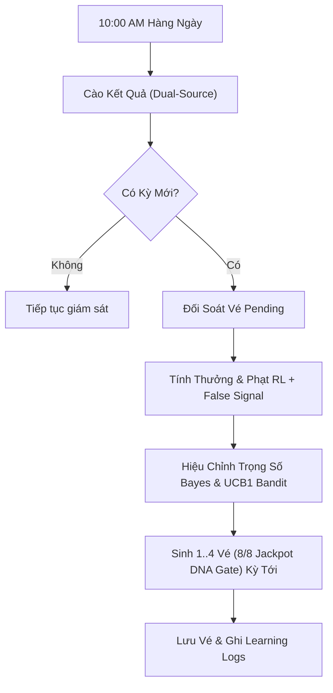

# 📖 Hướng Dẫn Vận Hành Hệ Thống (Operations Manual)

Tài liệu vận hành nền tảng **Stochastic Matrix Lab (SML)** — phân tích xác suất Vietlott & vòng lặp tự học AI.

## 1. Tổng Quan Thành Phần
| Thành phần | Công nghệ | Cổng CasaOS (Mặc định) | Vai trò |
| :--- | :--- | :--- | :--- |
| **Frontend UI** | Next.js 15, React 19, Tailwind | `:3080` (`3000` container) | Giao diện, biểu đồ, sinh số & đối soát vé. |
| **Backend API** | FastAPI, Uvicorn, SQLAlchemy Async | `:8088` (`8000` container) | REST API, ma trận toán học, RL/Bandit, lưu DB. |
| **Database** | SQLite (`/app/data/vietlot.db`) | - | Kết quả kỳ quay, vé đã lưu, trọng số AI. |
| **Scheduler** | `asyncio` Background Task | - | Chạy ngầm chu kỳ tự học 10:00 sáng hàng ngày. |

## 2. Chu Kỳ Tự Động (Auto-Cycle 10:00 AM)
- **Mega 6/45:** Quay 18:00 Thứ Tư, Thứ Sáu, Chủ Nhật.
- **Power 6/55:** Quay 18:00 Thứ Ba, Thứ Năm, Thứ Bảy.

Worker [`backend/app/services/scheduler.py`](../backend/app/services/scheduler.py) chạy tuần tự mỗi ngày lúc 10:00 sáng:



1. **Cào dữ liệu:** Nguồn chính `vietlott.vn`, tự fallback sang GitHub Mirror khi lỗi/timeout.
2. **Đối soát vé:** Lọc vé `pending` khớp `target_draw_period`, tính giải thưởng & chuyển `evaluated`.
3. **Tự học & hiệu chỉnh:** Cập nhật 4 trọng số ($w_{lateness}+w_{gauss\_sum}+w_{hot}+w_{parity}=1.0$), tính bậc thang RL (Bậc 0..3) và điểm UCB1 Bandit.
4. **Sinh vé kỳ tới:** Tối ưu ứng viên theo 8/8 cổng Jackpot DNA và lưu vé `hybrid_ai_learned`.

## 3. Kích Hoạt Thủ Công (On-Demand)
- **Giao diện Web:** Mở `http://<HOST_IP>:3080` → khối *Chu Kỳ Tự Học* → bấm **`⚡ Kích Hoạt Vòng Lặp Ngay`**.
- **REST API:**
```bash
# Kích hoạt chu kỳ ngay
curl -X POST "http://localhost:8088/api/v1/auto-cycle/run-now?game_code=mega_6_45"
curl -X POST "http://localhost:8088/api/v1/auto-cycle/run-now?game_code=power_6_55"

# Xem trạng thái trọng số & UCB1 Bandit
curl -s "http://localhost:8088/api/v1/auto-cycle/status?game_code=mega_6_45" | jq
```

## 4. Quản Trị, Sao Lưu & Kiểm Thử
```bash
# Khởi động / xem log / dừng với Docker Compose
docker compose up -d --build
docker compose logs -f
docker compose down

# Sao lưu SQLite
cp backend/vietlot.db backend/vietlot_backup_$(date +%Y%m%d_%H%M%S).db

# Chạy kiểm thử trên /tmp (bảo vệ SSD/HDD)
DATABASE_URL=sqlite+aiosqlite:////tmp/test_sml.db pytest tests -v -o cache_dir=/tmp/.pytest_cache
```

## 5. Xử Lý Sự Cố Thường Gặp
- **Bị chặn IP `vietlott.vn`:** Crawler tự động fallback sang GitHub Mirror và bộ dữ liệu baseline nhúng sẵn.
- **Vé chưa đối soát:** Kiểm tra kỳ mới qua `GET /api/v1/draws/latest?game_code=mega_6_45`, sau đó gọi `POST /api/v1/tickets/evaluate`.
- **Trùng cổng 3000/8000:** Dự án dùng mặc định `3080` (Frontend) và `8088` (Backend) để không xung đột với AdGuard Home / Portainer trên CasaOS.

## 6. Quy Tắc An Toàn
1. Không sửa tay trọng số trong bảng `ai_learning_states` để giữ chuẩn tắc tổng bằng `1.0`.
2. Giữ nguyên tắc đối soát tương lai (walk-forward), không đối soát hồi tố làm sai lệch dữ liệu học.
